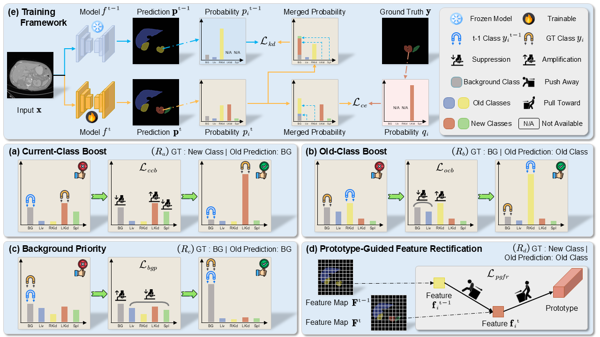

# Deconstructing Supervision

This is the official PyTorch implementation of our work: **Deconstructing Supervision: Rethinking Learning Signals in Class Incremental Medical Image Segmentation** published at ACM MM 2026.

**Coming soon...**

